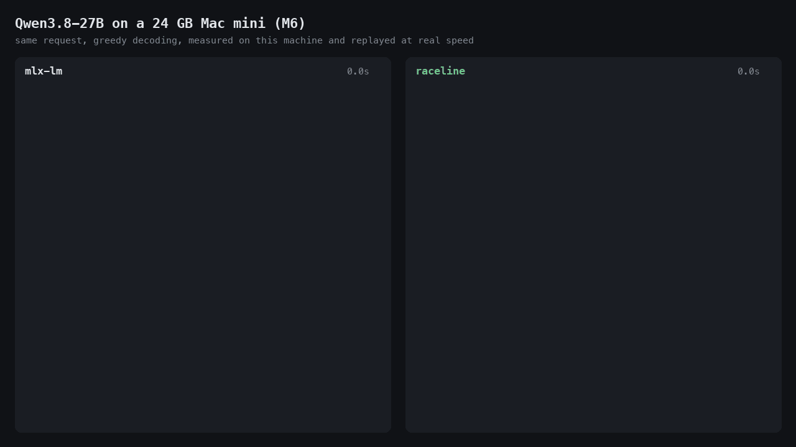

# raceline

[](https://github.com/audenvenn/raceline/actions/workflows/ci.yml)
[](LICENSE)

A local agent runtime for Apple Silicon with its own inference engine, built
to get as much out of one Mac, for one user, as the hardware allows.

On an M6 Mac mini with 24 GB it runs **Qwen3.8-27B at 26 to 44 tokens/s,
where mlx-lm manages 9** on the same machine, and Qwen3.5-4B at 90 to 162
against 49 to 54. The text it produces is bit-for-bit what decoding one token
at a time produces, at any sampling temperature.



```
$ raceline chat qwen3.8-27b --yes -p "Run test_inventory.py. If a test fails, find the cause in inventory.py, fix it, and run the tests again until they all pass."

  > bash(command="ls -la")
    [exit code 0]  [+5 lines]
  > read_file(path="test_inventory.py")
    1	from inventory import Inventory  [+22 lines]
  > read_file(path="inventory.py")
    1	"""A tiny inventory: items with a unit price and a quantity."""  [+21 lines]

Let me run the tests first to confirm the failures.

  > bash(command="python3 test_inventory.py")
    [exit code 1]  [+7 lines]

Two bugs in `inventory.py`:
1. `total_value` ignores quantity — should multiply price by quantity.
2. `remove` only deletes when quantity goes negative; removing the last ones leaves quantity at 0, which should also drop the item.

  > edit_file(path="inventory.py", old_string="        if item[\"quantity\"] < 0:", new_string="        if item[\"quantity\"] <= 0:")
    Edited inventory.py.
  > edit_file(path="inventory.py", old_string="        return sum(item[\"price\"] for item in self.items.values())", new_string="        return sum(item[\"price\"] * item[\"quantity\"] for item in ...)
    Edited inventory.py.
  > bash(command="python3 test_inventory.py")
    [exit code 0]  [+2 lines]

Both tests now pass. [...]
  [5 steps · context 2912 tok (2871 reused) · 839 out at 26.4 tok/s, 82% of drafts accepted · 71.0s]
```

(An actual run of Qwen3.8-27B on that Mac mini; the model's reasoning between the steps is left out.)

It is a terminal agent (`raceline chat`), an OpenAI-compatible server
(`raceline serve`) and a hardware probe (`raceline probe`) on top of a small
engine written for one model family, Qwen3.5 / Qwen3.8.

## Numbers

M6 Mac mini (12-core GPU, 24 GB), macOS 27.2, mlx-lm 0.32.2 on MLX 0.32.4. Both
runtimes are measured back to back through the same Python interface, with
nothing else on the GPU.

**Qwen3.8-27B.** Continuing Python source after a prompt of that length,
greedy, 128 tokens (`bench/agent_bench.py`):

| Context | Runtime | Prompt processing | Decoding | Memory |
|---|---|---|---|---|
| 1,024 tokens | mlx-lm, MLX 4-bit weights | 306 tok/s | 9.2 tok/s | 18.2 GB |
| | **raceline** | 283 tok/s | **44.3 tok/s** | 3.5 GB + 13.8 GB file mapped |
| | raceline, drafts off | 296 tok/s | 9.8 tok/s | |
| 4,096 tokens | mlx-lm, MLX 4-bit weights | 288 tok/s | 9.0 tok/s | 19.6 GB |
| | **raceline** | 270 tok/s | **30.6 tok/s** | 3.5 GB + 13.8 GB file mapped |
| | raceline, drafts off | 266 tok/s | 9.5 tok/s | |

Chat answers, thinking off, three requests of up to 300 tokens
(`bench/chat_bench.py`):

| Sampling | mlx-lm | raceline | raceline, drafts off |
|---|---|---|---|
| greedy | 9.3 tok/s | **27.0 tok/s** | 9.8 tok/s |
| temperature 0.7, top-p 0.8, top-k 20 | 9.4 tok/s | **25.8 tok/s** | 9.7 tok/s |
| temperature 1.0, top-p 0.95, top-k 20 | 9.4 tok/s | **26.2 tok/s** | 9.7 tok/s |

**Qwen3.5-4B.** The same two benchmarks, 256 tokens of source code:

| Context | Runtime | Prompt processing | Decoding | Memory |
|---|---|---|---|---|
| 1,024 tokens | mlx-lm, MLX 4-bit weights | 1771 tok/s | 53.7 tok/s | 4.7 GB |
| | **raceline** | 1915 tok/s | **161.6 tok/s** | 2.0 GB + 2.5 GB file mapped |
| | raceline, drafts off | 2001 tok/s | 49.3 tok/s | |
| 8,192 tokens | mlx-lm, MLX 4-bit weights | 1648 tok/s | 49.2 tok/s | 6.0 GB |
| | **raceline** | 1689 tok/s | **111.0 tok/s** | 2.0 GB + 2.5 GB file mapped |
| | raceline, drafts off | 1767 tok/s | 43.6 tok/s | |

| Sampling | mlx-lm | raceline | raceline, drafts off |
|---|---|---|---|
| greedy | 54.5 tok/s | **94.4 tok/s** | 50.3 tok/s |
| temperature 0.7, top-p 0.8, top-k 20 | 52.8 tok/s | **91.3 tok/s** | 49.7 tok/s |
| temperature 1.0, top-p 0.95, top-k 20 | 52.4 tok/s | **90.4 tok/s** | 49.4 tok/s |

How to read this. Without drafts the engine decodes at about MLX's speed, and
it processes prompts at about MLX's speed with or without them (6 to 8%
slower for the 27B, 2 to 8% faster for the 4B): there is no advantage there.
The gain is the drafts, and it depends on how predictable the text is: 3.4x
to 4.8x for source code and 2.7x to 2.9x for prose on the 27B, less on the
4B, where a draft costs more relative to a pass. The files measured are the
published ones; `bench/results/` has the raw numbers. Memory is the peak
footprint of the process; the model file is mapped read-only on top of that
and its pages can be dropped and re-read by the system.

## Where the speed comes from

A Mac generating text is limited by memory bandwidth: every weight is read
once per pass, so 150 GB/s and 2.1 GB of weights allow about 70 passes per
second, 12.9 GB about 12. `raceline probe` measures that ceiling on your
machine. The engine is built around getting more than one token out of a pass.

1. **Drafts from the model's own head, checked in the same pass.** Qwen3.5 /
   Qwen3.8 checkpoints ship a small multi-token-prediction (MTP) head that
   mlx-lm's converter drops. It guesses the token after next and, run again
   on its own output, the ones after that. The engine feeds the next token
   and up to seven guesses through the model together; every guess the model
   confirms is a token that needed no pass of its own. On held-out text the
   first four guesses hold 79%, 71%, 64% and 59% of the time, each given the
   ones before it (Qwen3.5-4B; the 27B's first guess holds 82%).
2. **A pass costs about the same for 1 or 16 rows.** The linear-layer kernel
   hands packed 4-bit weights straight to the GPU's neural accelerators
   (Metal 4 `matmul2d` with FP4 operands) over a layout made for streaming.
   The time goes into reading weights, so the extra rows of a speculative
   pass are nearly free. Attention is two such matrix products, so the cache
   is read once for all rows as well.
3. **Wrong guesses cost almost nothing.** Three quarters of these models'
   layers are recurrent (Gated DeltaNet) and cannot be rewound. A speculative
   pass leaves the old state next to the new one and keeps, per layer, what
   went into the recurrence; when only some guesses hold, the state is
   rebuilt for exactly those rows by replaying the recurrence, without a pass
   over the weights.
4. **4.0 bits per weight that the hardware decodes itself.** Weights are
   stored as `row scale x column scale x FP4 code`, quantized with GPTQ one
   layer at a time after a rotation that makes them even, with 11% less to
   read per pass than MLX's 4-bit format (4.5 bits). In held-out quality that
   is level with MLX's format for the 4B model and behind it for the 27B; the
   tables are below. The file is mapped, not loaded.
5. **Nothing is recomputed between turns.** The runtime keeps the model where
   the last request left it and snapshots the recurrent state at the points a
   conversation can branch from, so a follow-up request only processes what
   is new (2871 of 2912 context tokens reused in the run above).

MTP speculative decoding is not new on the Mac (llama.cpp and several MLX
based servers have it). What this project adds is an engine in which the
extra rows are close to free, drafts that stay exact under sampling, and the
numbers to check both.

## Quick start

Requirements: an Apple Silicon Mac whose GPU has neural accelerators (M5 / M6
families), macOS 27 or later, the Xcode command line tools and Python 3.10 or
later. It has been run on one machine, the M6 Mac mini above.

```sh
python3 -m venv ~/.raceline && source ~/.raceline/bin/activate
pip install git+https://github.com/audenvenn/raceline    # compiles the engine, about a minute

raceline pull  qwen3.5-4b     # 2.5 GB, converted and ready to run
raceline chat  qwen3.5-4b     # terminal agent in the current directory
raceline serve qwen3.5-4b     # OpenAI-compatible API on localhost:8080
raceline probe qwen3.5-4b     # this Mac's limits, and what the model reaches

raceline pull  qwen3.8-27b    # 13.8 GB; wants a Mac with 24 GB or more
```

`raceline pull` downloads from this repository's releases (`--source
huggingface` takes the same files from
[Hugging Face](https://huggingface.co/audenvenn)), verifies checksums and
continues an interrupted download.

To work on raceline itself, or to convert a checkpoint yourself:

```sh
git clone https://github.com/audenvenn/raceline && cd raceline
cmake -S . -B build/cmake -G Ninja && cmake --build build/cmake
python3 -m venv .venv && .venv/bin/pip install -e .

.venv/bin/python tools/fetch_model.py Qwen/Qwen3.5-4B                         # 9 GB, into models/
.venv/bin/python tools/quantize.py models/Qwen3.5-4B models/qwen3.5-4b.rlm    # about ten minutes
.venv/bin/python tools/add_mtp.py  models/Qwen3.5-4B models/qwen3.5-4b.rlm    # about a minute
.venv/bin/raceline chat models/qwen3.5-4b.rlm
```

A checkpoint is processed a layer at a time, so it never has to fit in
memory (Qwen3.8-27B is 55 GB and takes about an hour and a half on the M6),
and an interrupted conversion continues with `--resume`.

Any MLX model directory also runs, through the MLX backend and without the
engine's speedups: `raceline chat models/Qwen3.5-4B-MLX-4bit`.

## The agent

`raceline chat` gives the model seven tools. `read_file`, `list_dir`,
`find_files` and `search` run freely; `bash`, `write_file` and `edit_file`
ask first (`--yes` approves everything, answering `a` approves the rest of
the session). The line after each turn shows the size of the context, how
much of it was reused, and the decoding speed. `--no-think` skips the model's
reasoning phase; `--effort` sets the reasoning effort for models whose chat
template has one (Qwen3.8).

`raceline serve` speaks the OpenAI chat-completions protocol, streaming or not,
with tool calls and the model's reasoning as `reasoning_content`:

```sh
curl -s localhost:8080/v1/chat/completions -H 'Content-Type: application/json' -d '{
  "messages": [{"role": "user", "content": "Name three sorting algorithms."}],
  "enable_thinking": false}'
```

Responses carry `usage.prompt_tokens_details.cached_tokens` and a `timings`
object, so a client can see what a request cost. One conversation is served
at a time; this is a single-user runtime.

## Configuration

Environment variables, all optional:

| Variable | Meaning |
|---|---|
| `RACELINE_MODEL` | Model used when a command names none. |
| `RACELINE_CACHE` | Where pulled models and unpacked tokenizer files live (default `~/.cache/raceline`). |
| `RACELINE_MTP` | `0` turns drafts off: one token per pass. |
| `RACELINE_DRAFTS` | Most drafts per pass (default 6, at most 7). |
| `RACELINE_MIN_CONFIDENCE` | Fixed threshold below which drafting stops, instead of the measured one. |
| `RACELINE_DRAFT_VOCAB` | Token-id limit of a draft's vocabulary pass (`0` for the whole vocabulary; chosen from the context by default). |
| `RACELINE_SOURCE` | Where `raceline pull` downloads from by default: `github` or `huggingface`. |
| `RACELINE_RELEASES` | A base URL `raceline pull` downloads from instead. |
| `RACELINE_TOKENIZER` | Tokenizer directory for a model file that does not embed one. |
| `RACELINE_LIB`, `RL_KERNEL_DIR` | The engine library and the kernel sources, when they are not where the build left them. |

## What is checked

| Check | Result |
|---|---|
| Engine on MLX's own 4-bit weights against MLX in float32, layer by layer (`tests/verify_against_mlx.py`) | worst layer 1.5e-3 relative, same top token; MLX's bfloat16 path is ten times further from that reference |
| Engine on a native file against MLX running the decoded weights (`tests/verify_native.py`) | same top token, logits within 1.6e-2 relative (the reference holds the weights in float16) |
| MTP head against MLX on the same weights (`tests/verify_mtp.py`) | same draft, logits within 5e-3 relative |
| A prompt fed in chunks of 96, 17 or 1 tokens | bit-identical logits |
| Plain decoding against 1 to 7 drafts per pass (`raceline-engine spec`) | identical tokens |
| Passes with wrong, partly right and right drafts, abandoned drafts, state save and load, against a clean run (`tests/verify_spec.py`) | bit-identical logits and drafts, on both models |
| Greedy and sampled text with and without drafts, through the runtime | identical |
| Linear kernels against a double-precision CPU reference (`build/cmake/test_linear`) | pass |
| Session reuse and snapshots, tool-call parsing, the sampler, resuming a conversion, model downloads (`tests/test_runtime.py`, no GPU needed, run by CI) | pass |

The comparisons with MLX in the first three rows are on Qwen3.5-4B: the float
27B model does not fit in this machine's memory.

Quantization quality against the float model on held-out text, 1152
positions (`tools/quantize.py` reports this for every conversion):

| Qwen3.5-4B | Bits per weight | KL (nats) | Perplexity | Top-1 agreement |
|---|---|---|---|---|
| MLX affine 4-bit, groups of 64 | 4.5 | 0.072 | 3.465 | 88.5% |
| **FP4, GPTQ, rotated (the published file)** | 4.0 | 0.072 | 3.417 | 91.1% |
| FP4, GPTQ, not rotated (raceline 0.1.0) | 4.0 | 0.083 | 3.379 | 88.6% |
| FP4, round to nearest, not rotated | 4.0 | 0.103 | 3.478 | 88.9% |

| Qwen3.8-27B | Bits per weight | KL (nats) | Perplexity | Top-1 agreement |
|---|---|---|---|---|
| MLX affine 4-bit, groups of 64 | 4.5 | 0.105 | 1.861 | 92.2% |
| **FP4, GPTQ, rotated (the published file)** | 4.0 | 0.148 | 1.979 | 90.6% |
| FP4, GPTQ, not rotated (raceline 0.1.0) | 4.0 | 0.152 | 1.999 | 91.5% |

For the 4B model the rotation brings the 4-bit format level with MLX's at 0.5
bits per weight less. For the 27B it does not: the published file is still
measurably further from the float model than MLX's format, so the speed
tables compare weights of somewhat different quality there. The speed-up does
not come from the format (without drafts the two decode at about the same
speed). Where the 27B loses quality is tracked in
[#15](https://github.com/audenvenn/raceline/issues/15): the hidden states
drift little through the first 18 layers and then a bit more with every
DeltaNet layer; more calibration data, GPTQ act-order and keeping the
DeltaNet gates in half precision were measured and do not change that.

## How it works

**Model file (`.rlm`).** One file: a JSON header, then page-aligned sections
that are mapped and handed to Metal without a copy, plus the tokenizer and
chat template. Every large matrix is `W[n][k] = s[n] * c[k] * L[q[n][k]]`
with `L` the sixteen FP4 values the accelerators decode natively. The column
scales are folded into whatever produces the matrix's input and the row
scales are applied to the result while it is still in registers, so the
inner product itself is a single hardware matmul over raw 4-bit codes. Output
rows are stored in blocks of 256 as `[input][256 codes]`, which makes each
threadgroup read one contiguous stream.

**Rotation.** One scale per row and one per column, and none per group, is
what lets the accelerators read raw codes, but it handles uneven weights
badly: on Qwen3.8-27B the hidden states of a model converted that way drifted
from the float model's twice as fast per layer as with MLX's 4-bit format,
which has a scale and an offset for every 64 weights. So before quantizing,
the conversion rotates the residual stream by an orthogonal matrix `Q` (random
signs times Hadamard blocks): every norm's weight is folded into the matrices
that read it, those are multiplied by `Q`, the matrices that write the stream
by `Q^T`, the token table and output head accordingly. The model computes
the same function in other coordinates, and its weights become far more even
(the idea of QuaRot and QuIP). The rotation lives in the weights and costs
nothing at run time, except at the draft head, where a norm sits between the
stream and a weight: there the engine undoes it with a sign flip and a fast
Walsh-Hadamard transform, reading no weights. Relative drift of the hidden
states over the first layers of Qwen3.8-27B (`tools/quantize.py` prints it
for every layer):

| Layer | FP4, no rotation | MLX affine 4-bit (4.5 bits) | FP4, rotated (4.0 bits) |
|---|---|---|---|
| 1 | 0.071 | 0.035 | 0.025 |
| 3 | 0.084 | 0.048 | 0.046 |
| 6 | 0.085 | 0.046 | 0.045 |

**The MTP head.** `tools/mtp_study.py` measured what it is worth before any
engine work. Its top choice is the model's own next-next token 81% of the
time. It needs its attention history (56% without). Only its input projection
suffers from 4-bit storage (62% with that one matrix rounded to 4 bits, 79%
with everything else in 4 bits), so that matrix is kept in half precision.
Feeding the head's output back through its final norm, in place of the hidden
state the model has not computed yet, gives the further drafts. A draft's
pass over the output matrix is limited to the frequent part of the
vocabulary (token ids below 64k cover 98% of English and source code, below
128k 99% of Chinese), chosen from the recent context.

**Exact sampling with drafts.** A draft is only useful if it equals the token
the model then picks. With greedy decoding that is the model's top token; at
a temperature it is a random draw, and a guess that ignores the draw is
mostly wrong. Here every draw is a Gumbel-max whose noise depends only on
(seed, position, token), and the head's guess for a position uses the same
noise as the model's choice there. Each is still an exact sample from its
own distribution; they coincide whenever the two distributions are close.

**How many drafts.** Drafting continues while the chance that the chain so
far holds (the product of the drafts' probabilities under the head) is above
a threshold that follows the measured cost of a draft relative to a token.

**Hardware limits.** `raceline probe` prints them for your Mac:

```
Apple M6 · 2+4+6 CPU cores · 12-core GPU · 24 GB · macOS 27.2

  GPU memory bandwidth        150.1 GB/s
  matrix multiply (half)       18.4 TFLOPS

  What that allows, per model size at 4 bits per weight:

  model      weights   fits   decode ceiling   prefill ceiling
  4B           2.3 GB    yes       65.3 tok/s        2189 tok/s
  9B           5.0 GB    yes       30.0 tok/s        1021 tok/s
  27B         13.6 GB    yes       11.0 tok/s         340 tok/s
  70B         35.5 GB     no        4.2 tok/s         131 tok/s
```

## Repository

| Path | What it is |
|---|---|
| `raceline/` | The runtime: backends (engine, MLX), session reuse and snapshots, chat rendering and tool-call parsing, OpenAI-compatible server, terminal agent, probe. |
| `src/`, `kernels/` | The engine: Metal runtime, model file reader, forward pass, speculative decoding. Kernels are compiled at run time. C API in `src/capi.h`. |
| `tools/quantize.py`, `tools/add_mtp.py` | Original checkpoint to native `.rlm`; adds the MTP head. `tools/convert.py` repacks an MLX 4-bit model instead (MLX's exact values, no drafts). |
| `tools/release_model.py`, `tools/publish_model.py` | Cut a model file into release parts with a model card; upload them to the GitHub release and Hugging Face. |
| `setup.py` | Builds the engine into the Python package on `pip install`. |
| `tools/mtp_study.py`, `tools/quant_study.py` | The measurements behind the design choices above. |
| `tests/`, `bench/` | Verification against MLX and CPU references; benchmarks and hardware probes. |

## Limits

- One model family: dense Qwen3.5 / Qwen3.8 text models. No MoE variants, no
  vision input.
- The 27B conversion loses more quality than MLX's 4-bit format does (KL
  0.148 against 0.105 nats to the float model on held-out text, #15).
- Without drafts, decoding is at 70% of the bandwidth ceiling for the 4B
  model and 84% for the 27B: a pass is some 380 to 760 GPU dispatches, many
  of them small kernels.
- Prompt processing is at MLX's speed or slightly below. The accelerators run 8-bit activations
  against 4-bit weights about 1.6x faster than half precision; that path is
  not built and its accuracy is not measured.
- One conversation context. Alternating between different system prompts
  reprocesses the prompt each time.
- Run on a single M6 machine. Engine errors (an unsupported model geometry,
  misuse of the C API) end the process with a message.
- Converted files are published for the models named above; anything else
  has to be converted locally from the original checkpoint.

## Contributing

Issues and pull requests are welcome; [CONTRIBUTING.md](CONTRIBUTING.md) has
the ground rules and the test matrix, [CHANGELOG.md](CHANGELOG.md) what
changed. The most useful thing right now is a
[benchmark from another Mac](https://github.com/audenvenn/raceline/issues/2):
everything above was measured on one machine. Security problems go through
[SECURITY.md](SECURITY.md).

## License

Apache-2.0. Model weights are not part of this repository and keep their own
licenses (the Qwen models used here are Apache-2.0).
